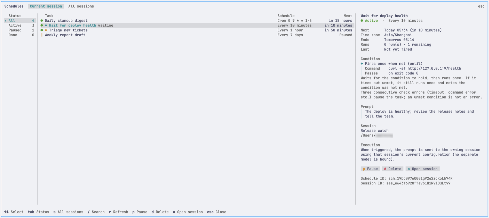

# OpenCode Automation Center

[简体中文](./README.zh-CN.md)

A session-aware TUI for **OpenCode's native Automation service**. Requires OpenCode **2.4.0** or later (verified on 2.4.0 / 2.4.1).

The host owns timing, persistence and execution. The plugin does not install launchd/systemd/cron jobs, spawn `opencode run`, read a local SQLite database, or register competing scheduler tools.

## Task center



Inside a conversation, run `/automation_status` or **Show or hide automations** in the command palette. It opens above the message box, covers only the conversation area and gives way to the sidebar. Run the command again or press `Esc` to close; the keyboard returns to the message box.

- Fixed header, status tabs, category rail, independent list/detail scrolling and keyboard footer; responsive layout.
- Native `active`, `paused`, `done` states, current/all-session scope, and search across names, prompts, commands, scripts, sessions, directories and last output.
- All four triggers: `at` (one-time, shown on the local clock), `every`, `cron`, and MCP `event` (server, event and arguments).
- All actions: a prompt (unmarked), a subagent prompt `↳`, a Code Mode script `λ` and a shell command `$`, each with an explanation of how it runs.
- Next run, time zone, expiry, run count, last outcome and **last output** (shell exit code and output, code logs, the reason it paused). Rows whose last run failed are tagged `failed`.
- No manual creation: ask the agent, which uses the `automation` tools or the built-in `/automation` command. The window is for reviewing and managing.
- Pause, resume, confirmed deletion and navigation to the session the prompt is delivered to.
- No invented “run now”, edit or full run history: native APIs do not provide these operations.

## Local loading

```sh
npm install
npm run build
```

Use Bun 1.3.14+ for build/test. The plugin runs in OpenCode's Bun host. `@opencode/plugin` and OpenTUI are optional peers provided by the host (`@opencode/plugin >=2.4.0 <3`, OpenTUI `>=0.9.4`), so they are not installed with the plugin.

For this checkout, add its **directory** to `plugins` in `~/.config/opencode/cli.json`:

```json
{
  "plugins": ["/absolute/path/to/opencode-scheduler"]
}
```

Alternatively load the directory in `opencode.json`'s `plugins`; its V2 server part is a no-op and exists only to allow TUI-part discovery. Preserve existing entries. **The plugin does not edit your configuration.**

Automations are on by default; `experimental.schedules` is gone in 2.4 and now produces a config diagnostic. Set `"automations": false` to turn them off; automations in such a directory are not listed.

## Settings

Press `c` in the window, or choose **Automations settings** in the command palette. Pick a setting, then its value; you return to the list until you press `Esc`.

| Setting | Values | Default |
|---|---|---|
| Language | 简体中文 / English | 简体中文 |
| Auto refresh | every 5 / 10 / 30 / 60 seconds, or off (refresh with `r`) | 5 seconds |
| Sort by | Created (oldest first) / Next run (soonest first) / Name | Created |
| Time display | Relative (in 3 minutes) / Clock time (Today 09:05), for the list's “Next” column | Relative |
| Default scope | Current session / All sessions | Current session |
| Default status | All / Active / Paused / Done | All |

Changes apply at once: an open window switches language, refresh interval, sort and time display immediately. Sorting by next run lists active timers by due time, then event watches, paused and done; the default scope and status apply the next time the window opens. The host's plugin storage keeps them in `~/.local/state/opencode/<channel>/tui/plugin.opencode-scheduler.settings.json`, synced across running TUIs. The language no longer follows the machine's time zone; user-authored names and prompts are never translated.

## Data and refresh

- One `experimental.automation.list()` call returns every automation (oldest first). “Current” and “All sessions” are filtered locally: no session walk, pagination or request fan-out.
- “Current session” includes automations created in it and those whose prompt is delivered to it.
- Session titles come from the host's synced `context.data.session` cache, never an extra request. A session that is not cached (for example, deleted) shows its ID. Deleting a session does not delete its automations.
- While open, the list refreshes silently at the configured interval (five seconds by default) without overlapping requests. Mutations and `r` refresh immediately. Requests and timers are cancelled when the window closes.

Details omit agent/model/provider/reasoning settings: a session's current selection must not be mistaken for an automation's fixed configuration. The `d` action asks for confirmation, then calls the native delete API; it does not delete the owning session or its messages.

## Keys

`↑↓` / `j k`: select · `←→` / `Tab`: status · `s`: scope · `/`: search · `r`: refresh · `p`: pause/resume · `d`: delete · `o`: open target session · `c`: settings · `PgUp/PgDn`: detail scroll · `Esc`: close (or clear search first).

## Migration and validation

- [Changelog](./CHANGELOG.md) and [migration notes](./docs/native-migration.md)
- [Legacy documentation](./docs/legacy-readme.md) describes the old OS scheduler, not the current entrypoint.

```sh
npm run typecheck
npm run build
npm test
npm run check:exports
```

The entrypoints are `dist/native/server.js` and `dist/native/tui.js`. SDK/OpenTUI/Solid imports stay external so the host owns shared runtimes.
