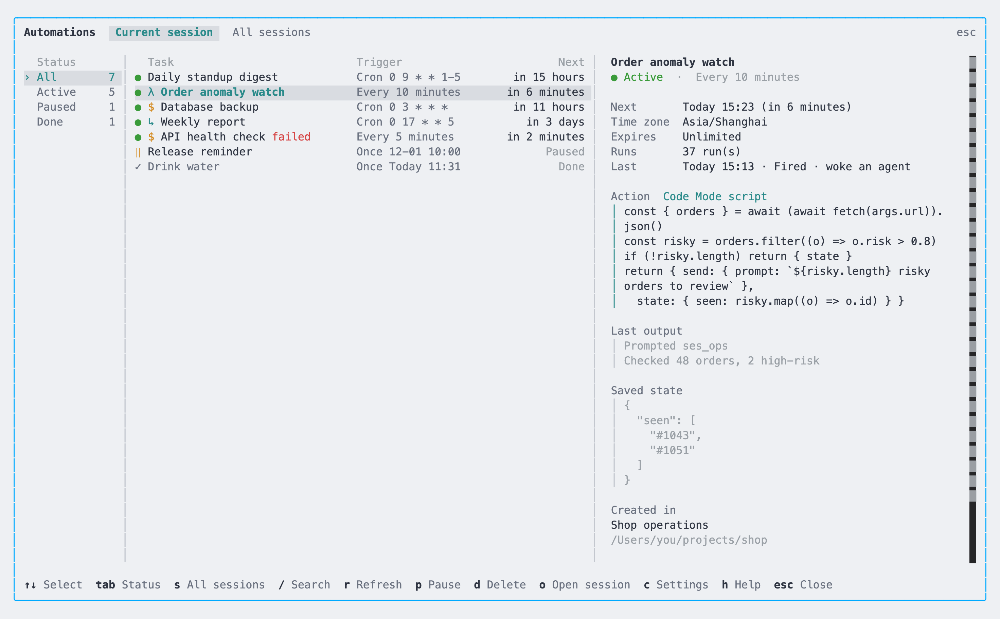
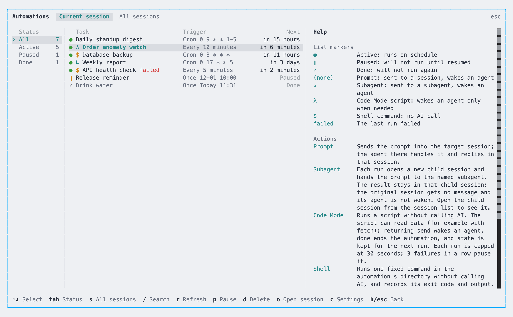

# OpenCode Automations Center

[简体中文](./README.zh-CN.md) · [npm](https://www.npmjs.com/package/@ookam147/opencode-scheduler-tui) · [Changelog](./CHANGELOG.md)

A TUI plugin for viewing and managing OpenCode's **native Automations** from inside a session: see when each automation runs, what it does and how its last run went, and pause, resume or delete it.

Requires OpenCode **2.4.0** or later (verified on 2.4.0 / 2.4.1). OpenCode owns timing, storage and execution; this plugin only reads and manages. It installs no system timers, spawns no processes and registers no competing scheduler tools.



## Install

```sh
opencode plugin add @ookam147/opencode-scheduler-tui
```

This installs the plugin from npm and adds it to `plugins` in the global `~/.config/opencode/opencode.json`. Restart OpenCode to load it.

Or add it by hand:

```json
{
  "plugins": ["@ookam147/opencode-scheduler-tui"]
}
```

Automations are on by default. To turn them off for a directory, set `"automations": false` in its config; its automations are then not listed.

## Quick start

1. **Create automations** by asking the agent, e.g. “Summarize yesterday's commits at 9 on weekdays” or “Remind me to drink water in 30 minutes”. It uses the `automation` tools or the built-in `/automation` command. The plugin has no creation form.
2. **Open the window**: run `/automation_status` in a session, or choose **Show or hide automations** in the command palette (`ctrl+p`). It opens above the message box.
3. **Review and manage**: `↑↓` selects, the right pane shows details; `p` pauses or resumes, `d` deletes, `o` opens the session its prompt goes to (usually the one that created it).
4. **Unsure what a marker means?** Press `h` for help; `h` or `Esc` returns.
5. **Close** with `/automation_status` again or `Esc`; the keyboard returns to the message box.

## List markers

| Marker | Meaning |
|---|---|
| `●` | Active: runs on schedule |
| `‖` | Paused: will not run until resumed |
| `✓` | Done: will not run again |
| (none) | Prompt: sent to a session, wakes an agent |
| `↳` | Subagent: sent to a subagent, wakes an agent |
| `λ` | Code Mode script: wakes an agent only when needed |
| `$` | Shell command: no AI call |
| red `failed` | The last run failed |

The same explanations are one keypress away (`h`):



## Triggers and actions

**Triggers** (the Trigger column):

| Trigger | Example | Shown as |
|---|---|---|
| `at` | once, in 30 minutes | Once Today 15:30 |
| `every` | every 10 minutes | Every 10 minutes |
| `cron` | 9:00 on weekdays | Cron 0 9 * * 1-5 |
| `event` | when an MCP server pushes an event | Event server/event |

**Actions** (the Action line in the details):

| Action | Calls AI | What it does |
|---|---|---|
| Prompt | yes | Sends the prompt into the target session; the agent there handles it and replies in that session |
| Subagent `↳` | yes | Each run opens a new child session for the named subagent (e.g. `explore`, `general`). The result stays in that child session and the original session gets no message; find it in the original session's Subagents panel |
| Code Mode `λ` | when needed | Runs a script without calling AI. It can read data (e.g. with `fetch`); returning `send` wakes an agent, `done` ends the automation, and `state` is kept for the next run |
| Shell `$` | no | Runs one fixed command and records its exit code and output |

Neither prompts nor subagents have a model setting of their own: a prompt uses the target session's current model, a subagent uses its own configured model.

## Details

| Field | Content |
|---|---|
| Next / Time zone / Expires | When it runs next, its time zone, when it stops |
| Runs | Total run count |
| Last | When it last ran and how. For Code Mode, whether that run woke an agent |
| Action | Its kind and content; a subagent reads “Subagent name” |
| Sends to | Shown only when a prompt goes to a session other than the one that created it |
| Last output | A shell's exit code and output, a script's logs, or why it paused |
| Saved state | Data a Code Mode script keeps for its next run |
| Created in | The session and directory it was created in |

OpenCode keeps only the **last** run's result, not a per-run history, so “Runs” counts woken and quiet runs together. To track them, count in a Code Mode script's `state`, e.g. `wakes + 1` whenever it returns `send`.

## Keys

| Key | Action |
|---|---|
| `↑↓` / `j k` | Select |
| `←→` / `Tab` | Status filter (All / Active / Paused / Done) |
| `s` | Current session / all sessions |
| `/` | Search names, prompts, commands, scripts, sessions, directories and last output |
| `r` | Refresh now |
| `p` | Pause / resume |
| `d` | Delete (asks first; deletes the automation only, not its session or messages) |
| `o` | Open the session the prompt goes to; for subagent, code and shell automations, the creating session |
| `c` | Settings |
| `h` | Help (`h` or `Esc` returns) |
| `PgUp` / `PgDn` | Scroll details |
| `Esc` | Close (clears the search first) |

“Current session” includes automations created in it and those whose prompt is sent to it.

## Settings

Press `c` in the window, or choose **Automations settings** in the command palette. Pick a setting, then its value; you return to the list until you press `Esc`.

| Setting | Values | Default |
|---|---|---|
| Language | 简体中文 / English | 简体中文 |
| Auto refresh | every 5 / 10 / 30 / 60 seconds, or off (refresh with `r`) | 5 seconds |
| Sort by | Created (oldest first) / Next run (soonest first) / Name | Created |
| Time display | Relative (in 3 minutes) / Clock time (Today 09:05), for the list's “Next” column | Relative |
| Default scope | Current session / All sessions | Current session |
| Default status | All / Active / Paused / Done | All |

Language, refresh, sort and time display apply at once; the default scope and status apply the next time the window opens. Settings live in `~/.local/state/opencode/<channel>/tui/plugin.opencode-scheduler.settings.json` and sync across running TUIs.

## Data and refresh

- Each refresh is one request for every automation; “Current” and “All sessions” are filtered locally.
- Session titles come from OpenCode's own session cache, never an extra request; an uncached session (for example, a deleted one) shows its ID. Deleting a session does not delete its automations.
- While open, the list refreshes silently at the configured interval without overlapping requests; pause, delete and `r` refresh at once; closing the window cancels requests and timers.
- No “run now”, in-place editing or per-run history: the native API offers none.

## From source

```sh
npm install
npm run build
```

Building and testing need Bun 1.3.14+. `@opencode/plugin` and OpenTUI are optional peers provided by OpenCode (`@opencode/plugin >=2.4.0 <3`, OpenTUI `>=0.9.4`). Add the checkout's **directory** to `plugins`, keeping existing entries:

```json
{
  "plugins": ["/absolute/path/to/opencode-scheduler-tui"]
}
```

Development:

```sh
npm run typecheck
npm test
npm run build
npm run check:exports
npm run screenshots   # regenerate the HTML frames behind the README screenshots
```

Entrypoints are `dist/native/server.js` (an empty server part that lets OpenCode discover the plugin) and `dist/native/tui.js`.

## More

- [Changelog](./CHANGELOG.md)
- [Migration notes](./docs/native-migration.md): from 2.x (native schedules) to 3.0 (native Automations)
- [Legacy documentation](./docs/legacy-readme.md): the 1.x system-timer implementation, no longer used

## License

MIT
