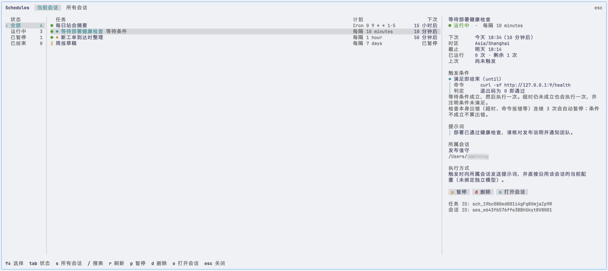

# OpenCode Automation 任务中心

[English](./README.md)

适配 **OpenCode 原生 Automation** 的会话级 TUI 管理界面，需要 OpenCode **2.4.0** 及以上（已核对 2.4.0 / 2.4.1）。

调度、存储与执行均由 OpenCode Service 负责。本插件不安装 launchd/systemd/cron，不启动独立 `opencode run`，不直读 SQLite，也不注册一套重复的调度工具。

## 界面与能力



在会话中输入 `/automation_status`，或在命令面板选择 **Show or hide automations**。窗口显示在对话框上方，只覆盖对话区域，开启侧边栏时自动让位。再次输入命令或按 `Esc` 关闭，键盘焦点交还输入框。

- 固定标题、状态页签、分类侧栏、列表与详情独立滚动、底部快捷键；窄屏隐藏分类栏并调整布局。
- 原生 `active / paused / done` 状态；当前会话 / 所有会话切换；按名称、提示词、命令、脚本、会话、目录、上次输出搜索。
- 四种触发：`at`（单次，按本地时间显示）、`every`、`cron`、MCP `event`（显示服务器、事件与参数）。
- 三种动作：发送提示词（列表无标记）、发给子代理 `↳`、Code Mode 脚本 `λ`、Shell 命令 `$`；详情说明各自的执行方式。
- 显示下次运行、时区、过期时间、运行次数、上次结果与**上次输出**（Shell 退出码与输出、Code 日志、暂停原因等）；上次失败的任务在列表中标注「失败」。
- 不提供手动新建：直接让 agent 通过 `automation` 工具或内置 `/automation` 指令创建，本窗口负责查看与管理。
- 暂停、确认恢复、确认删除、跳转提示词所投递的会话。
- 不提供原生接口没有的“立即运行、原地编辑、完整逐次运行历史”。

## 本地使用

```sh
npm install
npm run build
```

构建、测试使用 Bun 1.3.14+。插件运行在 OpenCode 的 Bun 宿主中；`@opencode/plugin` 与 OpenTUI 由宿主提供，是可选的对等依赖（`@opencode/plugin >=2.4.0 <3`、OpenTUI `>=0.9.4`），不会随插件安装。

在 `~/.config/opencode/cli.json` 的 `plugins` 中添加项目**目录**，不要覆盖已有插件：

```json
{
  "plugins": ["/absolute/path/to/opencode-scheduler"]
}
```

也可以在 `opencode.json` 的 `plugins` 中加载此目录；V2 server 入口仅用于发现 TUI，不启动调度器。配置可热加载，必要时运行 `/reload`。**本插件不会自动修改你的加载配置。**

Automation 默认开启，无需再配置 `experimental.schedules`（2.4 已移除该项，保留会产生配置诊断）。如需关闭，在相应配置中设置 `"automations": false`；关闭的目录中的任务不会出现在列表里。

## 设置

在窗口里按 `c`，或在命令面板选择 **自动化任务设置**（英文界面为 **Automations settings**）。选一项后选择取值，保存后回到设置列表，按 `Esc` 退出。

| 设置 | 取值 | 默认 |
|---|---|---|
| 界面语言 | 简体中文 / English | 简体中文 |
| 自动刷新 | 每 5 / 10 / 30 / 60 秒，或关闭（只按 `r` 手动刷新） | 每 5 秒 |
| 排序方式 | 创建时间（最早在前）/ 下次运行（最近在前）/ 名称 | 创建时间 |
| 时间显示 | 相对时间（3 分钟后）/ 具体时间（今天 09:05），作用于列表「下次」一栏 | 相对时间 |
| 默认范围 | 当前会话 / 所有会话 | 当前会话 |
| 默认状态 | 全部 / 运行中 / 已暂停 / 已结束 | 全部 |

修改立即生效，打开着的窗口会直接切换语言、刷新间隔、排序和时间显示；按「下次运行」排序时，有确定时间的运行中任务在前，其后依次是事件监听、已暂停、已结束；默认范围和默认状态在下次打开窗口时使用。设置由宿主的插件存储保存在 `~/.local/state/opencode/<channel>/tui/plugin.opencode-scheduler.settings.json`，同时运行的多个 TUI 会同步。界面语言不再根据电脑时区判断；任务名称和提示词不会被翻译。

## 数据读取

- 一次 `experimental.automation.list()` 读取全部任务（服务端按创建时间排序），「当前会话 / 所有会话」只在本地筛选，不再遍历会话、分页或并发请求。
- 「当前会话」包含：在本会话创建的任务，以及提示词投递到本会话的任务。
- 会话标题取自宿主已同步的 `context.data.session` 缓存，不额外请求；缓存中没有的会话（如已删除）只显示 ID。删除会话不会删除其创建的任务。
- 打开窗口时按设置的间隔（默认 5 秒）静默刷新，请求不重叠；操作后、按 `r` 立即刷新；关闭窗口取消请求与计时器。
- 时间来自原生接口的毫秒时间戳，按本地格式展示，任务时区单独列出。

详情不显示 Agent、模型、供应商或推理档位，避免将会话当前选择误解成任务锁定的执行配置。`d 删除` 会先确认，再调用原生删除 API；不会删除所属会话或其消息。

## 快捷键

| 按键 | 操作 |
|---|---|
| `↑↓` / `j k` | 选择任务 |
| `←→` / `Tab` | 切换状态分类 |
| `s` | 当前 / 所有会话 |
| `/` | 搜索（输入期间隔离操作快捷键） |
| `r` | 刷新 |
| `p` | 暂停 / 恢复；已结束任务无此操作 |
| `d` / `o` | 确认删除 / 打开目标会话 |
| `c` | 打开设置 |
| `PgUp/PgDn` | 滚动详情 |
| `Esc` | 先清除搜索，再关闭 |

## 迁移与验证

从 2.x（原生 schedule）升级的变更见 [CHANGELOG](./CHANGELOG.md) 与[迁移说明](./docs/native-migration.md)。旧版 OS 调度实现见 [旧版文档](./docs/legacy-readme.zh-CN.md)。

```sh
npm run typecheck
npm run build
npm test
npm run check:exports
```
