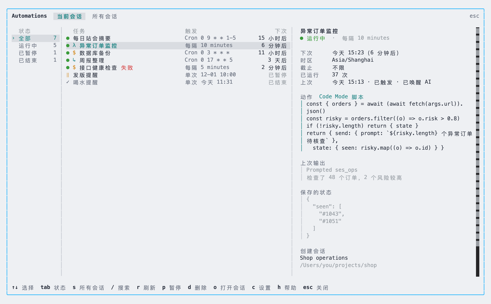
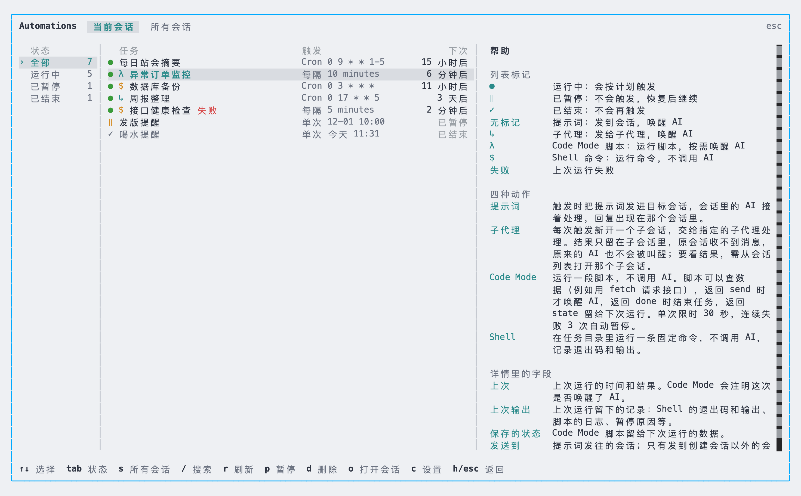

# OpenCode Automations 任务中心

[English](./README.md) · [npm](https://www.npmjs.com/package/@ookam147/opencode-scheduler-tui) · [更新日志](./CHANGELOG.md)

在 OpenCode 会话里查看和管理**原生 Automation（自动化任务）**的 TUI 插件：一眼看清每个任务何时运行、做什么、上次结果如何，并可暂停、恢复、删除。

需要 OpenCode **2.4.0** 及以上（已核对 2.4.0 / 2.4.1）。调度、存储与执行都由 OpenCode 自己负责；本插件只读取和管理，不安装系统定时器，不另起进程，也不注册重复的调度工具。



## 安装

```sh
opencode plugin add @ookam147/opencode-scheduler-tui
```

命令会从 npm 安装插件，并写入全局 `~/.config/opencode/opencode.json` 的 `plugins`。重启 OpenCode 即可使用。

也可以手动添加：

```json
{
  "plugins": ["@ookam147/opencode-scheduler-tui"]
}
```

Automation 默认开启。某个目录不想用时，在该目录配置里写 `"automations": false`，其中的任务也不会显示。

## 快速上手

1. **创建任务**：本插件不提供新建界面，直接对 agent 说就行，例如「每个工作日 9 点总结昨天的提交」「30 分钟后提醒我喝水」。agent 会用 `automation` 工具或内置的 `/automation` 指令创建。
2. **打开窗口**：在会话里输入 `/automation_status`，或在命令面板（`ctrl+p`）选择「自动化任务」。窗口显示在对话框上方。
3. **查看与管理**：`↑↓` 选任务，右侧看详情；`p` 暂停 / 恢复，`d` 删除，`o` 打开提示词发往的会话（通常就是创建任务的会话）。
4. **看不懂某个标记**：按 `h` 打开帮助，再按 `h` 或 `Esc` 返回。
5. **关闭**：再次输入 `/automation_status` 或按 `Esc`，键盘交还输入框。

## 列表标记

| 标记 | 含义 |
|---|---|
| `●` | 运行中：会按计划触发 |
| `‖` | 已暂停：不会触发，恢复后继续 |
| `✓` | 已结束：不会再触发 |
| 无标记 | 提示词：发到会话，唤醒 AI |
| `↳` | 子代理：发给子代理，唤醒 AI |
| `λ` | Code Mode 脚本：运行脚本，按需唤醒 AI |
| `$` | Shell 命令：运行命令，不调用 AI |
| 红色「失败」 | 上次运行失败 |

这些说明在窗口里按 `h` 也能看到：



## 四种触发与四种动作

**触发**（「触发」一栏）：

| 触发 | 例子 | 列表显示 |
|---|---|---|
| `at` | 30 分钟后执行一次 | 单次 今天 15:30 |
| `every` | 每隔 10 分钟 | 每隔 10 minutes |
| `cron` | 每个工作日 9 点 | Cron 0 9 * * 1-5 |
| `event` | MCP 服务器推送事件时 | 事件 服务器/事件 |

**动作**（详情「动作」一行）：

| 动作 | 是否调用 AI | 说明 |
|---|---|---|
| 提示词 | 是 | 把提示词发进目标会话，会话里的 AI 接着处理，回复出现在那个会话里 |
| 子代理 `↳` | 是 | 每次新开一个子会话交给指定子代理（如 `explore`、`general`）。结果只留在子会话里，原会话收不到消息；在原会话的 Subagents 面板里能找到 |
| Code Mode `λ` | 按需 | 运行脚本，不调用 AI。脚本可以查数据（例如用 `fetch` 请求接口），返回 `send` 才唤醒 AI，返回 `done` 结束任务，返回 `state` 留给下次运行 |
| Shell `$` | 否 | 运行一条固定命令，记录退出码和输出 |

提示词和子代理都没有单独的「模型」设置：提示词用目标会话当时选的模型，子代理用它自己配置的模型。

## 详情里能看到什么

| 字段 | 内容 |
|---|---|
| 下次 / 时区 / 截止 | 下次运行时间、任务时区、到期时间 |
| 已运行 | 总运行次数 |
| 上次 | 上次运行的时间和结果。Code Mode 会注明这次「已唤醒 AI」还是「未唤醒 AI」 |
| 动作 | 动作类型和内容；子代理会写成「子代理 名称」 |
| 发送到 | 只有提示词发到创建会话以外的会话时才显示 |
| 上次输出 | Shell 的退出码和输出、脚本日志、暂停原因等 |
| 保存的状态 | Code Mode 脚本留给下次运行的数据 |
| 创建会话 | 任务在哪个会话里创建、所在目录 |

OpenCode 只保存**上一次**运行的结果，没有逐次运行历史，所以「已运行 N 次」里唤醒和没唤醒的次数混在一起。需要统计时，可以在 Code Mode 脚本的 `state` 里自己记，例如每次唤醒时 `wakes + 1`。

## 快捷键

| 按键 | 作用 |
|---|---|
| `↑↓` / `j k` | 选择任务 |
| `←→` / `Tab` | 切换状态筛选（全部 / 运行中 / 已暂停 / 已结束） |
| `s` | 切换当前会话 / 所有会话 |
| `/` | 搜索名称、提示词、命令、脚本、会话、目录、上次输出 |
| `r` | 立即刷新 |
| `p` | 暂停 / 恢复 |
| `d` | 删除（会先确认；只删任务，不删会话和消息） |
| `o` | 打开提示词发往的会话；子代理、Code、Shell 任务打开创建会话 |
| `c` | 打开设置 |
| `h` | 帮助（再按 `h` 或 `Esc` 返回） |
| `PgUp` / `PgDn` | 滚动详情 |
| `Esc` | 关闭窗口（有搜索词时先清除搜索） |

「当前会话」包含在本会话里创建的任务，以及提示词发到本会话的任务。

## 设置

窗口里按 `c`，或在命令面板选择「自动化任务设置」。选一项后选择取值，保存后回到设置列表，按 `Esc` 退出。

| 设置 | 取值 | 默认 |
|---|---|---|
| 界面语言 | 简体中文 / English | 简体中文 |
| 自动刷新 | 每 5 / 10 / 30 / 60 秒，或关闭（只按 `r` 手动刷新） | 每 5 秒 |
| 排序方式 | 创建时间（最早在前）/ 下次运行（最近在前）/ 名称 | 创建时间 |
| 时间显示 | 相对时间（3 分钟后）/ 具体时间（今天 09:05），作用于列表「下次」一栏 | 相对时间 |
| 默认范围 | 当前会话 / 所有会话 | 当前会话 |
| 默认状态 | 全部 / 运行中 / 已暂停 / 已结束 | 全部 |

语言、刷新间隔、排序和时间显示改完立即生效；默认范围和默认状态在下次打开窗口时使用。设置保存在 `~/.local/state/opencode/<channel>/tui/plugin.opencode-scheduler.settings.json`，同时开着的几个 OpenCode 会同步。

## 数据与刷新

- 每次刷新只发一个请求，读取全部任务；「当前会话 / 所有会话」在本地筛选。
- 会话标题读自 OpenCode 已经缓存的会话信息，不额外请求；没缓存的会话（比如已删除）只显示 ID。删除会话不会删除它的任务。
- 窗口开着时按设置的间隔静默刷新，请求不重叠；暂停、删除和按 `r` 会立即刷新；关闭窗口即取消所有请求与计时器。
- 不提供原生接口没有的「立即运行、原地编辑、逐次运行历史」。

## 从源码使用

```sh
npm install
npm run build
```

构建和测试需要 Bun 1.3.14+。`@opencode/plugin` 与 OpenTUI 由 OpenCode 提供，是可选的对等依赖（`@opencode/plugin >=2.4.0 <3`、OpenTUI `>=0.9.4`）。把项目**目录**加入 `plugins`（不要覆盖已有插件）：

```json
{
  "plugins": ["/absolute/path/to/opencode-scheduler-tui"]
}
```

开发时常用：

```sh
npm run typecheck
npm test
npm run build
npm run check:exports
npm run screenshots   # 重新生成 README 截图用的 HTML 帧
```

入口是 `dist/native/server.js`（空的服务端部分，只用于让 OpenCode 发现插件）和 `dist/native/tui.js`。

## 相关文档

- [更新日志](./CHANGELOG.md)
- [迁移说明](./docs/native-migration.md)：从 2.x（原生 schedule）迁移到 3.0（原生 Automation）
- [旧版文档](./docs/legacy-readme.zh-CN.md)：1.x 的系统定时器实现，已不再使用

## 许可

MIT
